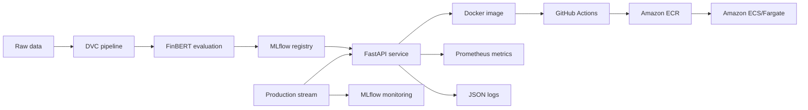

# Real-Time Financial News Sentiment Service

Production-oriented MLOps service that classifies financial headlines as
`positive`, `negative`, or `neutral` using FinBERT.

The project covers the complete model lifecycle: reproducible data preparation,
model evaluation and registration, automated quality gates, REST inference,
containerisation, AWS deployment, and production monitoring.

## Architecture



## Main capabilities

- Reproducible `prepare` and `clean` data stages with DVC.
- FinBERT evaluation tracked in MLflow.
- Model registration and automatic promotion through a `production` alias.
- FastAPI endpoints for individual and batch predictions.
- Integration tests and Locust load testing.
- Docker image with CPU-only PyTorch dependencies.
- Deepchecks drift quality gate.
- GitHub Actions CI/CD deployment to Amazon ECS.
- Structured JSON logs and Prometheus metrics.
- Windowed production monitoring stored in MLflow.

## Repository structure

```text
.
├── .github/workflows/ci-cd.yml       # CI/CD pipeline
├── infra/                             # AWS and GitHub setup automation
├── starter/
│   ├── app/                           # FastAPI application
│   ├── data/                          # Raw and DVC-generated datasets
│   ├── monitoring/stream.py           # Production traffic simulator
│   ├── scripts/                       # DVC, MLflow, quality and load scripts
│   ├── tests/                         # API integration tests
│   ├── dvc.yaml                       # Reproducible data pipeline
│   ├── docker-compose.yml             # Local API orchestration
│   ├── Dockerfile                     # Production image
│   ├── params.yaml                    # Pipeline and quality thresholds
│   └── prometheus.yml                 # Prometheus scrape configuration
├── LICENSE.txt
└── README.md
```

## Requirements

- Python 3.12
- [uv](https://docs.astral.sh/uv/)
- Git and DVC
- Docker with Docker Compose
- An AWS account with permissions for ECR, ECS, EC2, IAM and CloudWatch
- GitHub CLI for configuring CI/CD secrets

## Local setup

Clone the repository and enter the project:

```bash
git clone https://github.com/Jazielinho/mlops-financial-news-sentiment-service.git
cd mlops-financial-news-sentiment-service/starter
```

Create the environment and install the locked dependencies:

```bash
uv venv --python 3.12
source .venv/bin/activate
uv pip install --torch-backend cpu -r requirements.lock
```

Create the local configuration:

```bash
cp .env.example .env
```

Fill in the required values in `.env`. This file is ignored by Git and must
never be committed.

## Reproduce the data pipeline

```bash
dvc repro
dvc status
```

The pipeline creates:

- `data/train.csv` and `data/test.csv` from the `prepare` stage.
- `data/stream.csv` from the `clean` stage.

## Evaluate and promote the model

Start MLflow from the `starter` directory:

```bash
mlflow server \
  --backend-store-uri sqlite:///mlflow.db \
  --default-artifact-root ./mlartifacts \
  --host 0.0.0.0 \
  --port 5000
```

In another terminal:

```bash
source .venv/bin/activate
python scripts/evaluate.py
python scripts/promote.py
```

The evaluation run logs:

- Accuracy
- Weighted F1
- Weighted precision
- Weighted recall

The latest model version receives the `production` alias only when its weighted
F1 meets the threshold configured in `params.yaml`.

### Evaluation obtained

| Metric | Value |
|---|---:|
| Accuracy | 0.6384 |
| Weighted F1 | 0.5901 |
| Weighted precision | 0.6111 |
| Weighted recall | 0.6384 |

The configured promotion threshold is `0.56`, so model version 1 was promoted
to `production`.

## Run and test the API

Run locally:

```bash
python app/main.py
```

Or build the production container:

```bash
docker compose up -d --build api
docker compose ps
```

Available endpoints:

| Method | Endpoint | Purpose |
|---|---|---|
| `GET` | `/health` | Service and model readiness |
| `POST` | `/predict` | Single-headline prediction |
| `POST` | `/predict/batch` | Batch prediction |
| `GET` | `/metrics` | Prometheus metrics |

Example request:

```bash
curl -X POST http://localhost:8000/predict \
  -H "Content-Type: application/json" \
  -d '{"text":"Markets rise after strong earnings"}'
```

Run integration tests:

```bash
MODEL_SOURCE=huggingface pytest tests/ -q
```

Run the load test:

```bash
locust -f scripts/locustfile.py --host http://localhost:8000
```

## Quality checks

Deepchecks compares the test and production-stream datasets for NLP property
drift and prediction drift:

```bash
MODEL_SOURCE=huggingface python scripts/run_deepchecks.py
```

The command exits with a non-zero status when drift exceeds the thresholds in
`params.yaml`, preventing an unsafe deployment.

## Production monitoring

The API emits structured JSON logs and exposes:

- `prediction_requests_total{sentiment=...}`
- `prediction_latency_ms`
- `prediction_errors_total`

Prometheus is configured in `prometheus.yml` to scrape `api:8000/metrics`
every 15 seconds.

Generate simulated production traffic and log windowed metrics to MLflow:

```bash
python monitoring/stream.py
```

The monitoring run records positive, negative and neutral percentages, average
confidence, and average latency for each observation window.

The validated run processed 444 headlines in nine windows, while the API
reported zero inference errors.

## CI/CD and AWS deployment

Every push to `main` runs:

1. Ruff linting.
2. API integration tests.
3. DVC reproduction and the Deepchecks quality gate.
4. Docker build and push to Amazon ECR.
5. Deployment of a new task definition revision to Amazon ECS/Fargate.

The infrastructure helper creates or reuses the required ECR repository, ECS
cluster, task definition, service, security group, log group and execution role:

```bash
set -a
source starter/.env
set +a

bash infra/setup_aws.sh
bash infra/configure_github_secrets.sh
```

The CI/CD workflow requires these GitHub Actions secrets:

- `AWS_ACCESS_KEY_ID`
- `AWS_SECRET_ACCESS_KEY`
- `AWS_SESSION_TOKEN`
- `AWS_REGION`
- `ECR_REGISTRY`

The final workflow completed successfully, including the ECS deployment.

## Security notes

- `.env`, MLflow databases, artifacts, caches and generated datasets are not
  committed.
- AWS training-lab credentials are temporary and must be refreshed when expired.
- Production projects should prefer GitHub OIDC and short-lived IAM roles over
  stored access keys.

## License

This project is available under the terms in [LICENSE.txt](LICENSE.txt).
